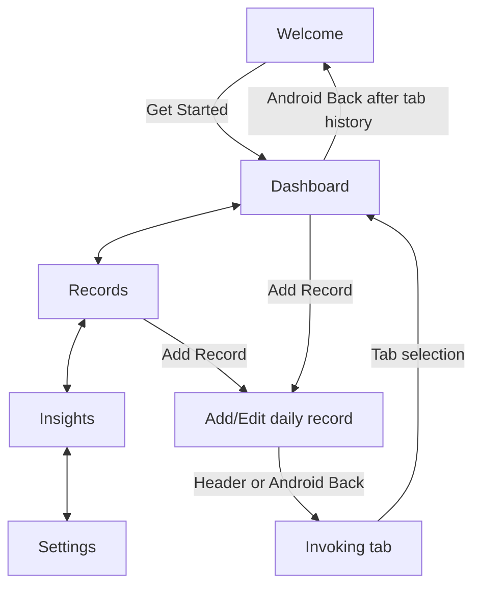
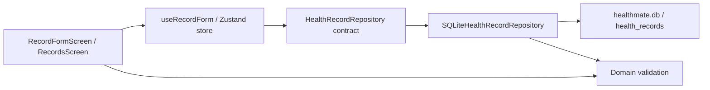
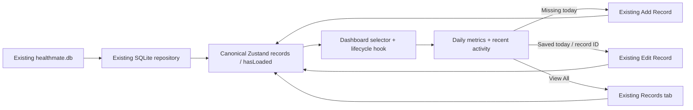

# HealthMate architecture

## Current structure

- src/app: Expo Router route files and root navigation layout. Routes delegate rendering to features.
- src/features/: welcome, dashboard, records (including Add Record), insights, and settings screens.
- src/components: AppScreen, AppHeader, AppText, AppCard, AppButton, AppIcon, EmptyState, and the original HealthIcon.
- src/theme: colors, typography, spacing, radius, border, elevation, icon and component-size tokens.

## Layer responsibilities

Domain models/contracts/validation, SQLite database/repository, and shared Zustand state are now implemented. Shared hooks now own record overview lifecycle for Dashboard and Insights.

| Location                 | Responsibility                                                                                                      |
| ------------------------ | ------------------------------------------------------------------------------------------------------------------- |
| src/features/<feature>/  | Screens, feature components, view-model hooks, and validation                                                       |
| src/hooks/               | Hooks shared by multiple features                                                                                   |
| src/domain/models/       | Framework-independent domain types                                                                                  |
| src/domain/repositories/ | Repository contracts expressed in domain types                                                                      |
| src/data/database/       | Implemented SQLite connection, configuration, migrations v1 (records) and v2 (goals); lecturer confirmation pending |
| src/data/repositories/   | Repository implementations using SQLite                                                                             |
| src/store/               | Zustand stores for cross-feature application state                                                                  |
| src/utils/               | Small shared pure helpers                                                                                           |

The intended dependency flow is View -> view-model hook -> repository interface -> repository implementation -> SQLite. Domain types must not import React or SQLite. Route files only compose navigation and feature screens. A feature can own local state; Zustand is reserved for shared state. No dependency injection framework or generic base repository is needed for initialization.

Core records are stored locally through Expo SQLite and work without a backend. Development loads JavaScript from Metro; this does not establish a production offline launch test. Models, repository contracts, validation, migrations, CRUD, exact-date filtering, Zustand state, and automated tests are implemented. The daily dashboard selects exact saved totals, personal goal progress and recent records. Insights derives weekly/monthly charts and statistics from canonical saved records. No cloud services, authentication, Flutter, paid dependencies, or native project modifications are included.

## Implemented navigation

The root Stack contains welcome (index), the four-tab group, add-record, and edit-record/[id]. Routes re-export feature screens. Both navigator headers are hidden; AppHeader supplies the sole visible title. Shared components do not import feature modules. Get Started pushes Dashboard, preserving welcome below it. Tabs use history back behavior. Add Record pushes onto the root stack so Back returns to the invoking tab; its header uses router.back with a Dashboard fallback for direct entry. No onboarding persistence is used. SDK 58 uses unstable_settings.anchor for stack/tab anchors.

```text
src/app/
  _layout.tsx
  index.tsx                / (welcome)
  (tabs)/
    _layout.tsx
    dashboard.tsx          /dashboard
    records.tsx            /records
    insights.tsx           /insights
    settings.tsx           /settings
  add-record.tsx           /add-record
  edit-record/[id].tsx      /edit-record/:id
```



All four tabs are directly selectable from every tab. The diagram abbreviates these links; Android Back traverses visited-tab history before popping the root stack.

## Implemented record data flow



The form view-model owns draft strings, field errors, load/retry state, and duplicate-date recovery. Zustand owns the canonical saved record list, loading/mutation flags, feedback, refresh, save and delete operations. It does not persist a second copy in AsyncStorage; SQLite is the source of truth. Mutations synchronize saved rows, sort newest first, and refresh after success. A revision guard prevents older loads from replacing newer mutations. Failed deletions keep their error visible for retry.

The composition module src/store/healthRecords.ts creates one repository behind the interface and injects it into createHealthRecordStore. Form lookup uses the same repository. No SQL appears in screens or hooks. Domain files import neither React nor SQLite. The database module owns a retryable singleton connection promise and completes initialization before returning it.

Records uses FlatList rather than nesting a virtualized list in AppScreen's ScrollView. Focus, foreground and pull-to-refresh reload SQLite. Exact-date filtering selects from that shared loaded list; the repository also supports parameterized date and date-range queries for tests and later consumers. Add/Edit share one form, with a separate typed edit route and ID-preserving updates. Native Alert supplies Cancel/Delete; no destructive operation runs on Cancel. Keyboard-aware scrolling and persistent taps keep actions reachable.

See database-design.md and crud-verification.md for schema, bounds, testing, fixtures and actual Android evidence.

## Functional daily dashboard

The route still re-exports DashboardScreen. useDashboard subscribes to the canonical saved record state, local date, load/error flags and lifecycle events. dashboardSelectors derives a discriminated loading/error/ready view model, one exact-date daily row, a smart Add/Edit descriptor and a newest-first three-record preview. It creates no additional record store, SQL query path or connection.

HealthMetricCard presents a saved measurement with its label, unit, accessible grouped reading and semantic accent. RecentRecordPreview provides a compact date and exact three-measurement summary. Both reuse shared UI primitives and centralized tokens.

A backward-compatible hasLoaded flag in the existing store is set only by successful full loads. Dashboard shows loading until that happens, gives errors precedence over missing data, and identifies cached background refresh. Existing mutation/revision guards remain intact.

createDashboardLifecycle is independently testable: navigation focus activates it, duplicate activation is ignored, foreground return rechecks the calendar and refreshes, and one timeout targets the next local midnight. Blur/background cancels it; focus/unmount removes the AppState subscription. Local calendar arithmetic supports leap days, timezone offsets and DST; no UTC slicing or minute-by-minute polling is used.



Full details and evidence: dashboard-design.md and dashboard-verification.md.

## Goals and calendar analytics

HealthGoalRepository and SQLiteHealthGoalRepository handle a nullable singleton settings row through the existing connection. A dedicated goal store shares saved settings with Settings and Dashboard; record state is not duplicated. Settings owns unsaved draft strings. Domain goal validation and pure progress functions remain independent of React/SQLite.

useRecordOverview shares focus, foreground and local-midnight behavior between Dashboard and Insights. The prior dashboardLifecycle module re-exports the shared pure controller for regression compatibility. Insights memoizes calendar positions and statistics from canonical saved records; selectors change only the presentation, without redundant SQL queries or maintained analytics caches. No current-goal comparisons are applied to historical activity. See goals-insights-design.md for migration v2, table diagram, formulas and component responsibilities, and goals-insights-verification.md for the 72-test result and native evidence.

## Activity calendar, logging streaks and CSV portability

A root /calendar stack route opens from Records, preserving four bottom tabs. Its feature screen uses canonical records and the shared focus/foreground/midnight hook. Domain month grids and validated date actions feed the existing Add/Edit form; calendar-origin Save pops back to the existing calendar. Existing callers retain their Records destination. Local calendar period helpers now live in domain/calendar/periods.ts; Insights re-exports them for existing consumers/tests.

Dashboard memoizes pure current/longest logging streaks from saved dates plus explicit local today. No streak or calendar tables/caches are persisted. Missing days and saved zeros remain distinct. CSV generation is pure domain TypeScript; feature orchestration injects a fresh existing repository read, a native File adapter and Expo Sharing. Settings owns confirmation/busy/feedback and a removable cache-file handle. Export uses no duplicate record state/connection and never uploads or logs CSV content. The root performs narrowly scoped expired-export cleanup without blocking the normal app. SQLite migrations v1/v2 and the record/goal stores remain unchanged.

See calendar-streaks-export-design.md for navigation/data-flow diagrams, date/streak algorithms, CSV rules, native sharing limitations and temporary-file lifetime; see calendar-streaks-export-verification.md for the 96-test suite and genuine emulator evidence.

## Prompt 08A integration

Runtime initialization now uses additive schema v3 through preferencesMigration; original migrations v1/v2 remain unchanged. Preferences have one SQLite-backed Zustand source, read by the reactive theme hook and the serialized local reminder reconciler. Quick water is a repository-level conditional atomic increment published through the existing record store. Backup/restore shares the connection and repository-operation gate; transaction completion is followed by canonical state replacement with revision invalidation. Trends remain pure derived data with no aggregate table. See feature-expansion-design.md for the complete persistence, privacy and comparison conventions.

## Prompt 09 runtime schema and feature integration

Runtime initialization now advances through the unchanged historical helpers to additive schema v4 in expandedMigration.ts. Notes/tags use cascading relationships; profile/layout use validated singleton payloads. All new views remain outside routes, domain selectors are independent of React/SQLite, and the existing shared connection gate protects CRUD/restore/reset. See prompt09-development.md for the current complete source architecture and verification boundaries. No native build or version bump was performed in this phase.
