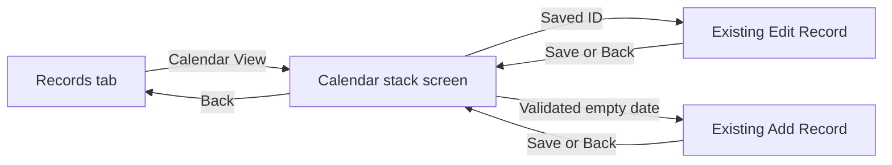
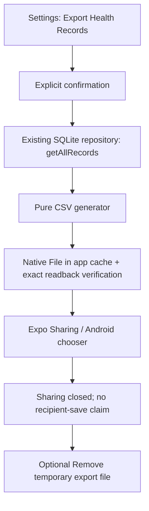

# Activity calendar, logging streaks and CSV export

Prompt 06 extends the existing offline-first application. It adds no database tables, migrations, health measurements, fifth tab, cloud service, sensors or goal-achievement claims.

## Calendar and navigation

Records retains its list, exact-date filter, CRUD and four-tab navigation. Calendar View pushes `/calendar` onto the root Expo Router stack. The dedicated Activity Calendar screen uses full safe-area insets and a Back action with Records fallback. Android Back pops to the existing Records tab. Calendar-origin Add/Edit pushes the existing form and pops back to that calendar after Save; its selected month/date state stays in the existing screen. Other Add/Edit actions retain the prior Records destination. Duplicate recovery also preserves the calendar return context.



`monthGrid` builds seven Monday-first columns with null outer padding. It produces only the required four/five/six rows and handles leap February. The month header and Previous/Next/Current month actions use the existing period arithmetic, moved unchanged from Insights to `domain/calendar/periods.ts`. Insights re-exports those functions for compatibility. The UI's previous-month lower bound is January 1900, matching the existing date picker; the forward bound is the current local month. Current month selects today.

Days show a saved marker ●, an unrecorded dash, or a future dot; a border and selected accessibility state identify selection. Today has a T suffix and a full spoken label. Selection is allowed on future days only to explain why logging is unavailable; no Add action is provided, even if unexpected future data exists. A saved 0/0/0 entry is still recorded. The details card displays real measurements or a missing/future explanation.

`calendarRecordAction` returns the exact saved edit ID or an Add route containing the selected ISO date. `resolveAddDate` rejects malformed, repeated/array and future parameters before the form uses them; omitted dates default to today. Existing record-form validation runs again on Save. No second form was introduced. Month/day business logic is outside the native screen.

Calendar uses `useRecordOverview` and canonical Zustand records. Focus, foreground and local-midnight lifecycle refreshes are shared with Dashboard/Insights. Saved state updates immediately on create/edit/date-change/delete; Calendar keeps no persisted cache or separate queries. Loading, refreshing and failed-load/retry are distinct from an empty day.

## Logging streak semantics

Logging Streak means consecutive local calendar dates with a saved daily entry. It says nothing about exercise, health quality or achieving targets. Zero measurements count. Duplicate dates count once; future dates never contribute.

`loggingStreaks(dates, today)` is pure and takes today explicitly. It validates dates, filters future dates, deduplicates them and sorts the unique dates. Longest scans the entire sorted history and increments a run only when the next date is the calendar successor. Current counts backwards from today if saved, otherwise yesterday; if neither is saved it is zero. Empty history gives 0/0. Month/year/leap boundaries use calendar `setDate` arithmetic, never timestamp differences divided by 86,400,000. Complexity is O(n log n) time and O(n) space; a 10,000-date test verifies the large-history path.

Dashboard memoizes results by canonical records and local today. It shows Current and Longest with correct day/days wording and a neutral explanatory caption. The summary is displayed only with usable record data; errors are not disguised as a zero streak. Nothing about streaks is persisted in SQLite.

## CSV format and architecture

Exact columns:

```csv
date,steps,calories_burned_kcal,water_ml
```

One row per actual saved record, oldest first. Dates are ISO YYYY-MM-DD, measurements are non-negative integer digits without locale separators, line endings are CRLF including the final line, and native File.write encodes UTF-8. No BOM is necessary because the current columns/data are ASCII-compatible UTF-8. IDs, goals, summaries and database paths are excluded. An empty dataset produces no file. Invalid data/duplicate dates fail rather than silently changing the export.

`recordsCsv` is a pure, non-mutating TypeScript transformation. `csvCell` doubles quotes, quotes delimiters/newlines and neutralizes spreadsheet formula prefixes for potential future text columns. Current validated date/integer fields cannot carry formulas. No import or evaluation of CSV content occurs.



`exportRecords` coordinates injected read/file/share dependencies, enabling deterministic failure tests without mocking native success. A fresh `getAllRecords` call intentionally exports all SQLite rows, independently of the Records filter or a stale screen snapshot. It uses the established repository/connection and does not maintain another record store. One database SELECT supplies a consistent export snapshot. Duplicate request guards cover confirmation and the asynchronous operation.

`nativeRecordExport` uses SDK 58's supported `File`, `Directory`, `Paths.cache`, async `write/text`, and `expo-sharing.isAvailableAsync/shareAsync`. It does not use legacy file-system APIs or broad external-storage permissions. File contents are read back and compared exactly before sharing. Write/readback failure removes the partial file. Sharing failure attempts cleanup and shows retryable feedback. No CSV contents are logged or uploaded by HealthMate.

The Settings Data Management card explains the fields and requires a second explicit Export CSV action. Cancel before confirmation creates no file. Empty, unavailable, busy and failure states have clear messages. The Android share promise returns void and does not distinguish chooser cancellation from successful recipient saving. Accordingly the UI says Sharing closed and explicitly declines to confirm another app's result.

## Temporary-file privacy and lifetime

The filename is `healthmate-records-YYYY-MM-DD.csv`, inside an app-controlled `healthmate-exports` cache directory. The generated file remains available while the chooser/recipient may read it. It is deliberately not immediately deleted when shareAsync resolves: Android can return before a receiving app finishes reading. After return, Remove temporary export file deletes only the app's copy. The next export removes the previous same-session copy and overwrites the date's filename. Files older than one hour are eligible for cleanup on the next app launch/export. This is event-driven cleanup, not a guaranteed one-hour background deletion. App termination can leave a cache copy until that cleanup or OS eviction. Copies explicitly saved in external apps are managed by those apps.

Cleanup is restricted to expected filenames in this specific cache directory; it never touches SQLite, unknown files or other applications. Startup cleanup failure cannot block normal record access. Export is optional and local until the user chooses an external destination. A chosen destination may have its own privacy/network behavior; no recipient was selected in verification.

## Dependencies, accessibility and limits

Added explicit SDK-compatible dependencies via `npx expo install`: expo-file-system ~58.0.10 (already present transitively) and expo-sharing ~58.0.19 (new package). The automatically registered sharing config plugin is retained without incoming-sharing options or app-identity changes. Expo Go already bundles these native modules. No chart/calendar/UI framework was added.

Same-day audit comparison: baseline 28 affected packages (8 moderate, 20 high); after installation 29 (9 moderate, 20 high). The additional affected package is expo-sharing through the already-flagged @expo/config-plugins chain; no new advisory identifier was introduced by this installation. npm proposes expo-sharing 14.0.8 as a major-version fix, incompatible with SDK 58. We retain the official supported module rather than downgrade the application or force audit fixes. React Native's core Share does not provide this same supported local-file workflow; avoiding the module would weaken the required feature. Reassess when Expo publishes a compatible remediation.

Calendar touch cells are at least 48 units wide and 68 high, with seven fixed columns and horizontal scrolling on narrower layouts. Text remains scalable; cells/rows expand for wrapping. Days have full date/today/saved/missing/future screen-reader descriptions, selected state, visible markers and labels independent of color. Month actions, form navigation, streak wording and export messages reuse existing primitives and tokens. Native 130% font and scroll checks are recorded separately. TalkBack navigation and arbitrary device widths remain broader validation work.

See [verification](calendar-streaks-export-verification.md) for automated/native results and genuine evidence. Existing schema v2, store mutation guards and all earlier tests remain intact.
