# Record management verification — 21 October 2026

## Scope and environment

Existing repository root, branch main, origin and clean Git state were verified. Expo 58.0.16, React Native 0.88.0, strict TypeScript and the established UI/navigation were preserved. Node 24.15.0 runs the tests. Device: Pixel_10 API 37.1 / Expo Go 58.0.5.

Ports 8081 and 8082 were occupied and left untouched. A dedicated Metro LAN server on port 8083 served the record-management build. No user database was cleared or table dropped. The device database was observed empty before manual record creation. Test records below are explicitly development evidence, not actual patient data.

## Automated results

29/29 tests passed with npm test. npm run typecheck checks both the app and tests; passed. npm run lint passed. npx expo install --check reported up-to-date dependencies. Expo Doctor passed 20/20. git diff --check passed.

Node's built-in SQLite executes the actual production migration and repository SQL through tests/sqliteAdapter.ts; these are real desktop SQLite integration tests, not a mocked repository demonstration. Validation tests are pure units. Store tests mostly use that SQLite repository; S04 adds a proxy-delayed read to reproduce a race and S05 injects an unavailable connection. No test claims that Node SQLite alone proves the Expo native bridge.

| Test ID | Scenario | Input | Expected result | Actual result | Status |
| --- | --- | --- | --- | --- | --- |
| V01 | Valid record and zero | 2024-02-29 / 0 / 300 / 1500 | Typed input accepted | Matched expected | PASS |
| V02-0 | Invalid steps value | empty | Field error; no valid input | Matched expected | PASS |
| V02-1 | Invalid steps value | negative -1 | Field error; no valid input | Matched expected | PASS |
| V02-2 | Invalid steps value | decimal 1.5 | Field error; no valid input | Matched expected | PASS |
| V02-3 | Invalid steps value | NaN | Field error; no valid input | Matched expected | PASS |
| V02-4 | Invalid steps value | Infinity | Field error; no valid input | Matched expected | PASS |
| V02-5 | Invalid steps value | abc | Field error; no valid input | Matched expected | PASS |
| V02-6 | Invalid steps value | exponential 1e3 | Field error; no valid input | Matched expected | PASS |
| V02-7 | Invalid steps value | unsafe 9007199254740992 | Field error; no valid input | Matched expected | PASS |
| V02-8 | Invalid steps value | over limit 200001 | Field error; no valid input | Matched expected | PASS |
| V03 | All numeric fields required/non-negative | Each empty or -1 | Corresponding field error | Matched expected | PASS |
| V04 | Calendar validation | Leap/non-leap/invalid month/day/year/syntax | Valid leap dates accepted; invalid dates rejected | Matched expected | PASS |
| V05 | Required/future dates | Empty / date after supplied today | Date error | Matched expected | PASS |
| V06 | Local calendar default | Local 2024-02-29 00:05 | 2024-02-29 without UTC shift | Matched expected | PASS |
| V07 | Repository input boundary | NaN, Infinity, unsafe, string, negative, decimal | Validation error | Matched expected | PASS |
| DB01 | Create and typed read/order | Two fixture rows | ID/date retrieval equal saved values; latest first | Matched expected | PASS |
| DB02 | Duplicate daily record | Same date with changed steps | Duplicate error with existing ID; no overwrite | Matched expected | PASS |
| DB03 | Update/retrieve/date collision | Changed values and date; then occupied date | Same ID updated; collision rejected | Matched expected | PASS |
| DB04 | Delete and missing IDs | Delete saved ID; repeat/update missing ID | Row absent; missing errors; reads return null | Matched expected | PASS |
| DB05 | Date lookup/range/no results | Fixture dates and empty date | Inclusive range and exact/no-result reads | Matched expected | PASS |
| DB06 | Direct SQL constraints | Invalid dates, negative, decimal, over-limit steps | SQLite CHECK rejects inserts | Matched expected | PASS |
| DB07 | Migration version/idempotence | Version 1 reopen; unsupported version 2 | Rows preserved; newer schema rejected | Matched expected | PASS |
| DB08 | File persistence | Close/reopen temporary SQLite file | Saved row survives | Matched expected | PASS |
| DB09 | Invalid query/ID/storage failure | Invalid ID/date/range and unavailable connection | Typed validation/storage errors | Matched expected | PASS |
| S01 | Shared CRUD state | Create/edit/delete via store | List and success feedback consistent | Matched expected | PASS |
| S02 | Failed deletion/retry | Record removed outside store | Failure remains visible; refresh reconciles list | Matched expected | PASS |
| S03 | Concurrent submission | Two overlapping saves | Second rejected as busy; only one insert | Matched expected | PASS |
| S04 | Stale refresh race | Delay old read until after save | New saved row retained and refreshed | Matched expected | PASS |
| S05 | Database load failure | Unavailable connection | Loading clears; retryable error; no rejection | Matched expected | PASS |

## Actual Android results

UI actions used native Android accessibility-tree inspection, input events and screenshots through adb. Saved-row values were read from history and key layouts visually inspected. Restart used am force-stop on Expo Go, then reopened the LAN application and navigated back into Records; JavaScript memory/Zustand could not retain that process's previous state.

| Test ID | Scenario | Input | Expected result | Actual result | Status |
| --- | --- | --- | --- | --- | --- |
| A | Empty device database | New healthmate.db | Empty state, no fixtures | Observed empty Records | PASS |
| B/C | Create and history | 2026-10-21; 7500 steps / 350 kcal / 1800 ml | Save to SQLite and list row | Saved feedback and exact values observed | PASS |
| D/E | Edit and updated history | Same record; 8200 steps / 350 kcal / 2000 ml | Update existing ID, no extra row | Edit prepopulated; updated row observed | PASS |
| F | Filter saved date | 2026-10-21 | Matching record only | Matching row and clear action observed | PASS |
| G | Filter empty date / clear | 2026-10-20 before second insert | No-results; clear restores full list | No-results and restored row observed | PASS |
| H | Duplicate daily record | 2026-10-21; 1 / 1 / 1 | No overwrite; offer edit existing | Duplicate error; edit existing opens 8200 / 350 / 2000 | PASS |
| I1 | Required inputs | Empty measurements | Required-field messages; no save | Messages observed on all three fields | PASS |
| I2 | Negative input | Steps -1; other fields 0 | Non-negative whole-number error | Error observed; not saved | PASS |
| I3 | Zero and past date | 2026-10-20; 0 / 0 / 0 | Valid second daily record, latest first | Zero row below 2026-10-21 observed | PASS |
| J | Cancel deletion | Delete 2026-10-20 then CANCEL | No deletion | Zero-valued record remained | PASS |
| K | Confirm deletion | Delete 2026-10-20 then DELETE | Remove selected row, preserve today | Deleted feedback; today row remained | PASS |
| L | Full app restart persistence | Force-stop/reopen Expo Go; enter Records | Remaining values survive; deleted row absent | 8200 / 350 / 2000 persisted; 2026-10-20 absent | PASS |
| N1 | Cancel edit | Cancel reused edit form | Return without change | Original values remained | PASS |
| N2 | Native calendar | Choose previous date and OK | Local ISO date updates | 2026-10-20 selected successfully | PASS |
| N3 | Keyboard and scrolling | Focus numeric field with Gboard shown; swipe | Numeric IME, Save/Cancel reachable | Numeric keyboard and actions above it visually verified | PASS |

The 2026-10-21 manually entered verification record remains on the emulator for inspection (8200 steps, 350 kcal, 2000 ml). The 2026-10-20 test record was deleted. New installations remain empty because no application seeding exists. These are test entries only.

## Issues encountered and resolved

1. Expo Go initially reported Cannot find native module 'ExpoSQLite'. SDK 58 documentation and package checks confirmed compatibility, and the installed APK contained SQLite classes. A full Expo Go process close/reopen resolved registration; no downgrade, reinstall, data reset, fake storage, or native project changes were needed. Startup then created the empty SQLite database and CRUD worked.
2. Node SQLite returns null-prototype row objects. The test adapter now maps them to ordinary records, matching Expo's row shape; production SQL was unchanged.
3. Node test modules needed Node typings. A separate strict tests/tsconfig.json keeps Node globals out of mobile compilation while npm run typecheck covers both projects.
4. React lint rejected synchronous load-state updates inside an effect. Retry handlers now set retry/loading state before the asynchronous lookup; the keyed edit form initializes load state correctly.
5. A state review found automatic refresh could clear a failed deletion message. Refresh now follows successful mutations; S02 confirms failure feedback survives and explicit Retry recovers.
6. Emulator hardware-keyboard mode initially hid the IME, and stylus mode showed a handwriting palette. For verification, the numeric Gboard IME was exposed, its scroll behavior checked, and both settings restored to their original values (show_ime_with_hard_keyboard=0; stylus_handwriting_enabled unset).
7. Very fast adb typing raced selectTextOnFocus; the harness now waits for focus and selects existing text before injecting numbers. The actual saved values were read back, not inferred from typed commands.

## Remaining limitations and deviations

- Lecturer confirmation of expo-sqlite as the React Native equivalent remains pending, as requested.
- Android date filtering is exact-day filtering over the canonical SQLite-loaded store list. Parameterized exact-date and range repository reads are independently tested; no remote search is used.
- Date picker starts at 1900-01-01; domain calendar validation additionally supports earlier ISO dates.
- No automated React component rendering suite was introduced. Domain/data/state automation and actual Android UI tests are separately documented above.
- TalkBack, exhaustive font-scale/device-size coverage, physical devices, device disk-full/corruption fault injection, and production packaged offline launch were not tested. Missing-record and failed-storage behavior is automated at domain/repository/store levels.
- npm install reports 28 upstream audit findings (8 moderate, 20 high). No forced incompatible dependency upgrades or downgrades were applied. Metro emitted environment color warnings.
- No encryption, backup/export, release build, dashboard calculations, charts, goals, cloud sync, authentication or notifications were added.

## Reproduce

From the repository root: npm ci; npm run typecheck; npm run lint; npm test; npx expo install --check; npx expo-doctor. Start Pixel_10 and run npx expo start --android --lan --port 8083 (or npm run android on a free default port). Fully reopen matching Expo Go after installing native-compatible modules if needed.

Automated sample fixtures are tests/fixtures/records.ts; npm test explicitly inserts them into disposable desktop databases. Never import these fixtures into application routes or initialize them on launch.

## Genuine emulator evidence

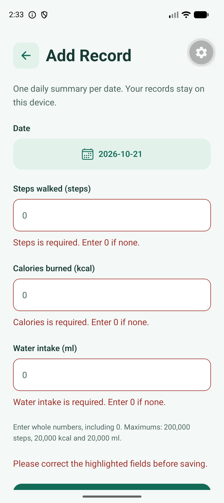

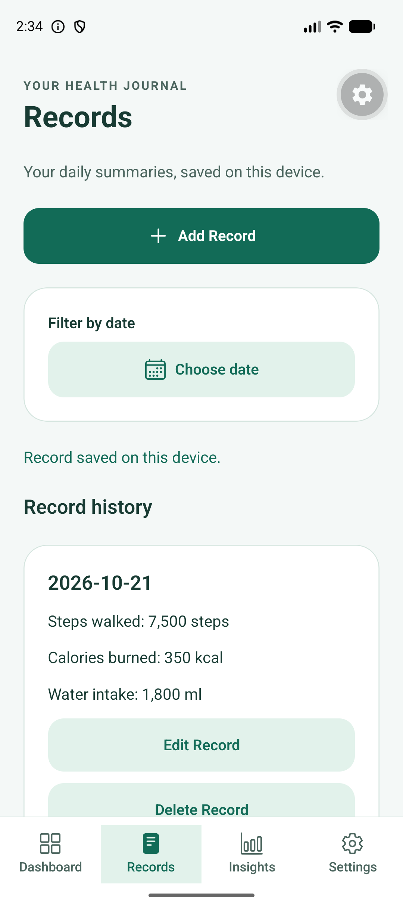

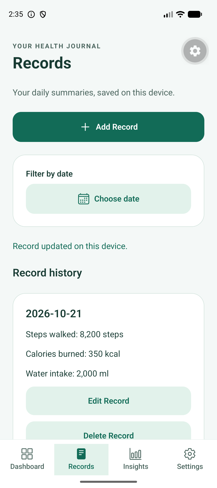

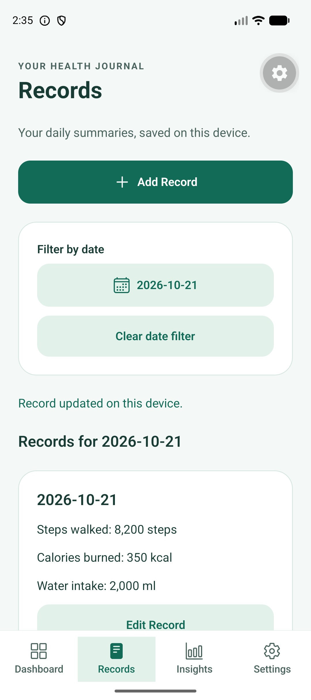

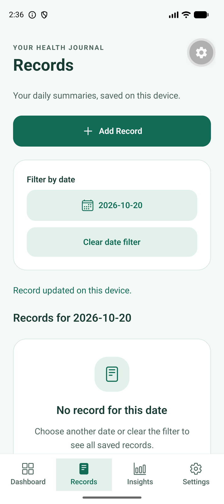

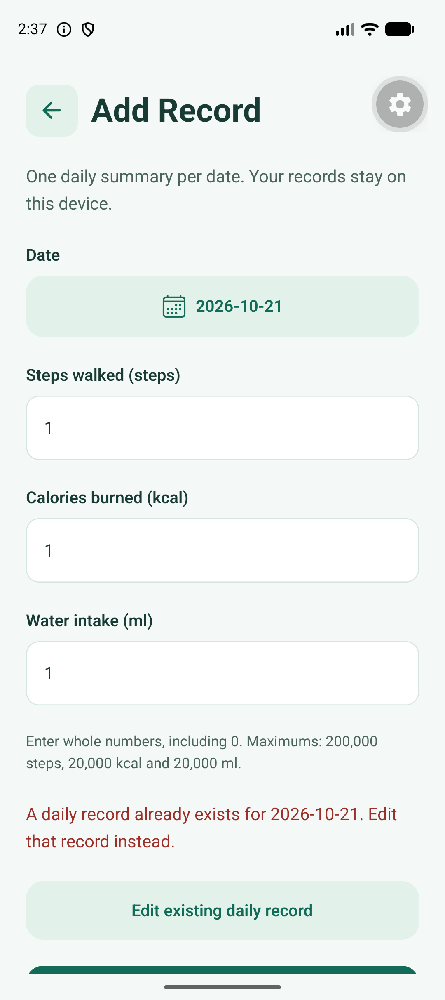

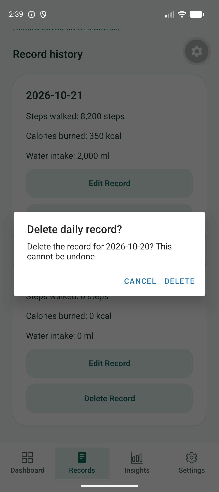

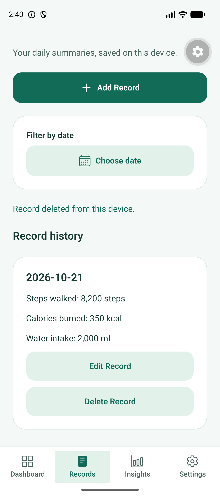

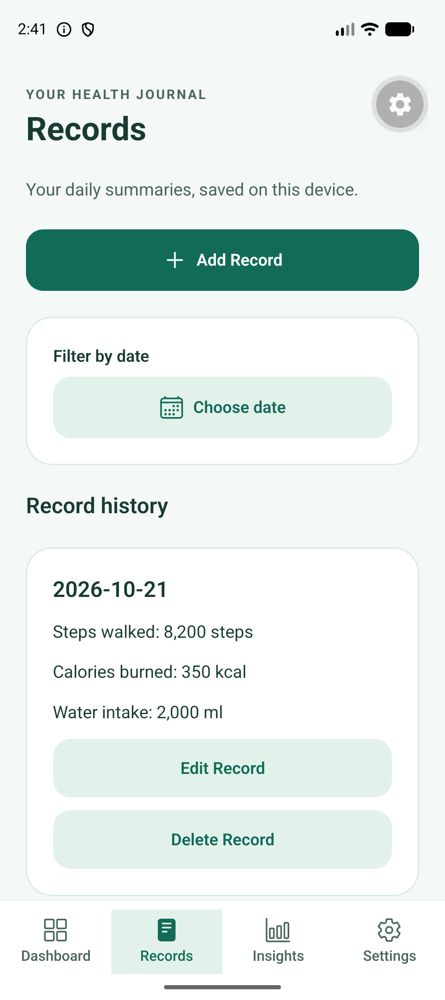

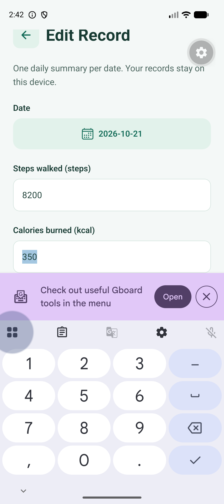

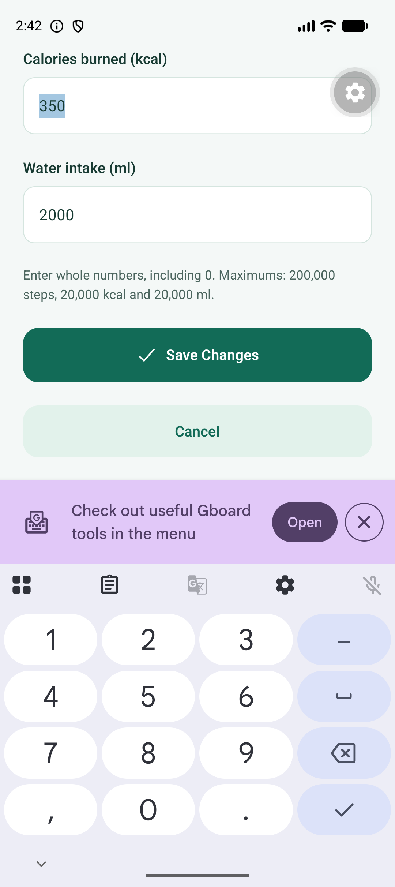
