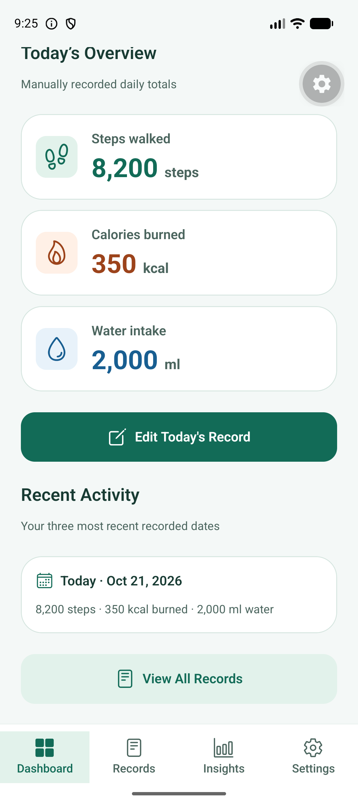
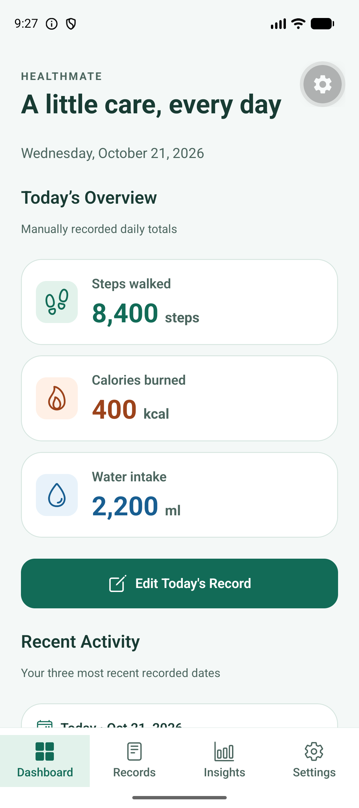
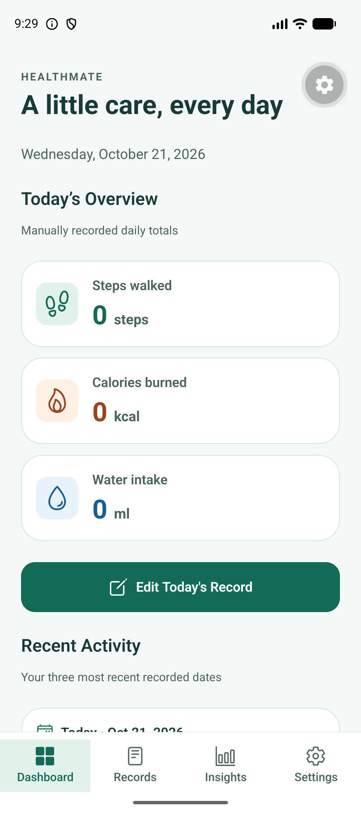
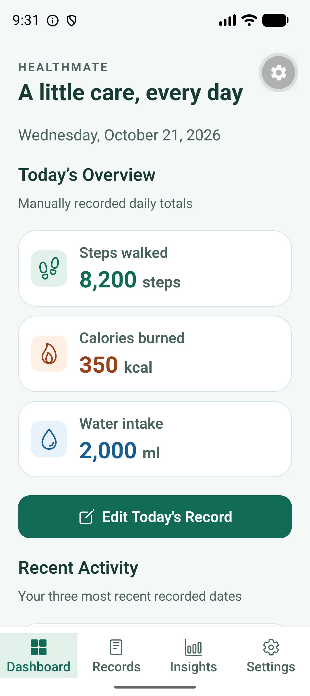
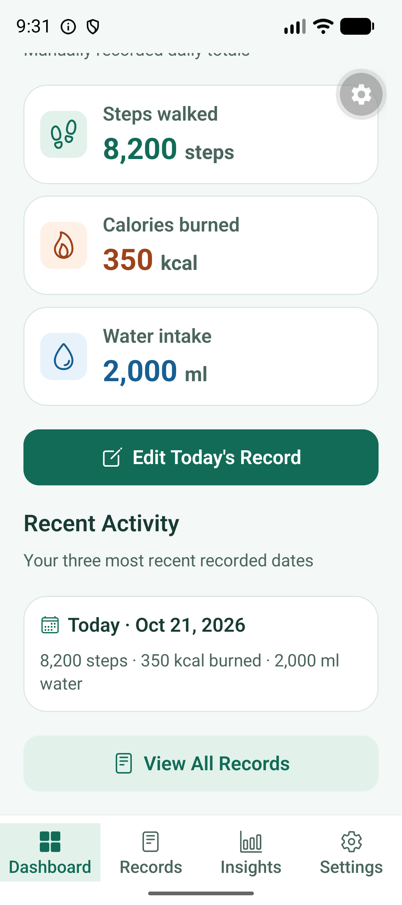

# Dashboard verification — 21 October 2026

## Baseline and preservation

Repository root, main branch, origin and clean status were verified before changes. Prompt 03 source, repository contracts, SQLite connection, schema v1, navigation and Add/Edit forms were preserved. No packages were added. Existing Metro servers occupied ports 8081, 8082 and 8083 and were left untouched; Prompt 04 used a dedicated LAN server on 8084.

Device: connected Pixel_10 / Expo Go 58.0.5. The device calendar date during verification was 2026-10-21. Its pre-existing manually entered test row contained 8200 steps, 350 kcal and 2000 ml. That row was never deleted and no new device record was created. It was temporarily edited only for the explicit update/zero tests and restored to its original values afterward.

## Automated verification

- npm run typecheck: PASS, both application and strict Node test projects.
- npm run lint: PASS, no diagnostics.
- npm test: 46/46 PASS, including all 29 unchanged Prompt 03 regression tests and 17 new dashboard tests.
- npx expo install --check: dependencies up to date.
- npx expo-doctor: 20/20 checks passed.
- git diff --check: PASS (Windows line-ending normalization notices only).

Tests D01–D04, D08–D09, D11 and D13 test pure selection/presentation logic. D05–D07 use the production repository/migration/store against real disposable Node SQLite. D10 uses a connection failure and then real SQLite to test recovery. D12 uses real SQLite plus a controlled lifecycle clock and refresh counter. D14–D16 use controlled clocks/schedulers/timezones. D17 delays one read to verify store coalescing. These are not automated React rendering or native-bridge tests. No production fixtures or measurement constants were added.

| Test ID | Scenario | Input | Expected Result | Actual Result | Status |
| --- | --- | --- | --- | --- | --- |
| D01 | No today row | Empty canonical list, successful load | Null today; no fabricated values; Add action | Matched expected | PASS |
| D02 | Saved daily row | 8200 steps / 350 kcal / 2000 ml plus another date | Exact single-row values; no summing | Matched expected | PASS |
| D03 | Saved zero row | 0 / 0 / 0 | Real zeros; Edit action | Matched expected | PASS |
| D04 | Today missing, previous rows present | Previous day; 2026-10-21 viewed as of 2026-10-22 | Daily missing plus genuine recent row | Matched expected | PASS |
| D05 | Create via SQLite/store | Controlled 2024-02-29 daily input | Dashboard selects saved ID and values | Matched expected | PASS |
| D06 | Edit via SQLite/store | Change steps to 9000, water to 2400 | Same ID; replaced values; one recent row | Matched expected | PASS |
| D07 | Delete via SQLite/store | Remove today in disposable DB | Daily missing; Add action, not saved zeros | Matched expected | PASS |
| D08 | Recent ordering and count | Four unsorted dates; then one row | Newest three; source order unchanged; no fabricated rows | Matched expected | PASS |
| D09 | Local date/number/date formatting | Asia/Colombo, Pacific/Honolulu, local 00:05; explicit en-US | No UTC shift; grouped values and correct labels | Matched expected | PASS |
| D10 | Failed load and retry | Injected unavailable connection, then real empty SQLite | Error state; hasLoaded false; retry reaches ready | Matched expected | PASS |
| D11 | Smart Add/Edit choice | Missing row, saved ID 17 and zero row | Correct label/kind/ID | Matched expected | PASS |
| D12 | Focus/foreground refresh | Real SQLite edit outside store; duplicate activation | Latest value after reactivation; exactly one refresh per activation | Matched expected | PASS |
| D13 | Initial versus cached loading | Not loaded, or cached row while refreshing | Initial loading only; cached data marked refreshing and action disabled | Matched expected | PASS |
| D14 | Local midnight | Controlled leap-day 23:59:59 -> March 1 | Date changes once; refresh/rearm; cancelled on blur | Matched expected | PASS |
| D15 | Background day change | Suspend Feb 29, resume March 1 | Updated local day; one timer; cleanup leaves none | Matched expected | PASS |
| D16 | DST scheduling | America/New_York 2024-03-10 midnight | Next local midnight in 23 hours plus 100 ms | Matched expected | PASS |
| D17 | Overlapping refresh requests | Deferred SQLite read, second refresh | One load; loading -> ready on completion | Matched expected | PASS |

## Android verification

Actions and hierarchy inspection used Android adb UI automation; evidence consists of actual device screenshots, not mockups. Successful Metro bundling is not used as proof of UI behavior.

| Test ID | Scenario | Input | Expected Result | Actual Result | Status |
| --- | --- | --- | --- | --- | --- |
| A01 | Launch and saved summary | Existing 2026-10-21 row; device date 2026-10-21 | Exact daily metrics, Edit Today | 8200 steps, 350 kcal, 2000 ml; correct action | PASS |
| A02 | Real recent activity | Same saved row | Matching date/values; no invented rows | Today · Oct 21, 2026 and 8200 / 350 / 2000 | PASS |
| A03 | View All/navigation | View All Records, then Dashboard tab | Existing history and dashboard remain consistent | Matching row in Records and Dashboard | PASS |
| A04 | Smart edit and refresh | Edit Today -> existing form; save 8400 / 400 / 2200 | Existing saved ID edited; dashboard updates without restart | Correct form values; updated metrics after tab return | PASS |
| A05 | Saved zero distinction | Temporarily save 0 / 0 / 0 | Three zeros and Edit action, not missing state | All three zeros displayed; Edit Today retained | PASS |
| A06 | Preserve existing test data | Restore 8200 / 350 / 2000 | Original values remain in same daily row | Records and Dashboard show restored values | PASS |
| A07 | Scroll and safe areas | Swipe dashboard/recent section | Recent preview and View All reachable | Reachable above tab/gesture bars; no obvious clipping | PASS |
| A08 | Font scaling | Temporarily set font_scale from 1.0 to 1.3 | Readable/wrapping content; actions reachable | Metric cards and navigation readable; View All reached by swipe; scale restored to 1.0 | PASS |
| A09 | Foreground return | Home key, reopen same LAN app | Current data and action remain correct | Dashboard retained restored values and real recent row | PASS |
| A10 | Full process restart | Force-stop and reopen Expo Go | SQLite-backed totals and recent row survive | Original 8200 / 350 / 2000 and Edit Today restored after process restart | PASS |
| A11 | Missing today / new creation | Existing today row intentionally retained | Preserve user/test row; test missing/create safely elsewhere | D01/D04/D05/D11 cover disposable/controlled cases; no user row deleted for an empty screen | Not performed on device |
| A12 | Database error/Retry | No device DB corruption introduced | Safe error/retry behavior | D10 covers unavailable connection and recovery; no native storage fault injected | Automated coverage only |
| A13 | Later-day interpretation | Device remained on 2026-10-21 | Oct 21 must stop being today on a later date | D04/D09/D14/D15 cover later dates/time changes; device clock left unchanged | Automated coverage only |

## Issues and solutions

1. Switching an already-running Expo Go to the new Metro instance reproduced the pre-existing Cannot find native module 'ExpoSQLite' error and consequent route-import warnings. A full process close/reopen resolved it without clearing data, reinstalling, altering the schema or changing dependencies. The successful subsequent workflow is documented above.
2. JSX lint flagged a raw apostrophe in the overview heading. The heading now uses typographic punctuation; lint passes.
3. An empty records array could previously mean either not-yet-loaded or genuinely empty. The canonical store now tracks hasLoaded only after a successful full read. Selector tests prove initial loading/error never masquerades as missing data.
4. Text-size changes recreated the emulator activity; the application was reopened before capturing the actual large-text dashboard. The captured evidence shows the dashboard, not the splash screen. Font settings were restored.

## Limits

No screenshots of fake empty/error data were generated. Native missing/create/delete scenarios were not forced by removing the pre-existing row; they are covered by disposable SQLite integration and selector tests. Midnight and DST handling use automated controlled clocks rather than changing the device date or waiting overnight. A full TalkBack walkthrough, additional physical devices, all font scales and packaged offline/release testing were not performed. No production crash or dashboard error was observed after the successful Expo Go reopen; runtime log checks are recorded with final verification.

The previously reported 28 upstream npm audit findings and lecturer confirmation for expo-sqlite remain outstanding; no packages, forced upgrades, downgrades or schema changes were introduced in this phase.

## Repeat checks

From the existing repository root run npm run typecheck, npm run lint, npm test, npx expo install --check, npx expo-doctor and git diff --check. With Pixel_10 running, use npx expo start --android --lan --port 8084 or a free port. Fully reopen matching Expo Go if its native module registration becomes stale.

## Final restart and runtime check

After a full process stop, Expo Go reopened to welcome; Get Started loaded the final dashboard with the original 8200 steps, 350 kcal and 2000 ml. The final cold-restart process PID was 23157. A filtered adb logcat query for ReactNativeJS errors in that process returned no error entries after dashboard navigation. Font scale was independently confirmed restored to 1.0. No device records were created or deleted.

## Genuine Android screenshots

