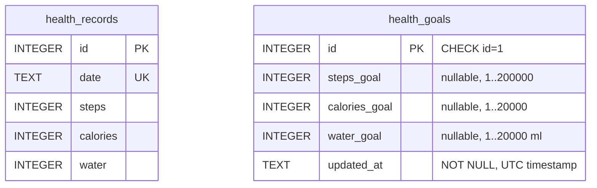
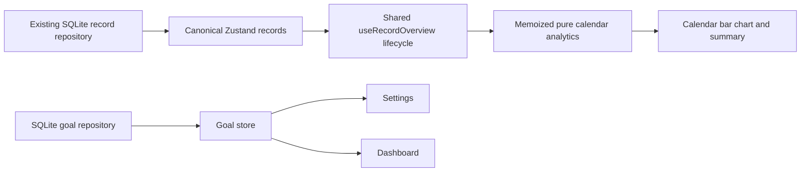

# Personal goals and activity Insights

Prompt 05 implements optional personal targets, current-day dashboard progress and calendar analytics. No sensors, recommendations, backend, goal history or new dependencies were added. Calories always mean calories burned.

## Persistence and migration

The existing `healthmate.db` connection remains the only connection provider. Migration v1's SQL and conditional body are unchanged. The existing BEGIN IMMEDIATE/COMMIT/ROLLBACK boundary now also runs additive v2 SQL and sets `user_version=2`. Fresh databases run v1 then v2; existing v1 databases only add the goal table. Reopening v2 does nothing to either table. Future versions are rejected before migrations. No activity table, IDs or records are rebuilt or deleted.

The tables have no foreign key relationship. One settings row applies to the local user, independently of dated activity. All goal columns allow NULL; configured values require SQLite integer storage and positive values within technical limits. These limits are input constraints, not health recommendations. No row is inserted until Save; a missing row maps to unset goals. Clearing all goals retains one row with three NULL values and an updated timestamp.

`HealthGoals` and `GoalValues` are framework-independent. `HealthGoalRepository.getGoals/saveGoals` provide complete replacement semantics: null explicitly clears that individual goal. `SQLiteHealthGoalRepository` validates writes and retrieved goal values, uses a single parameterized INSERT ON CONFLICT UPDATE, and returns only after persistence succeeds. The shared database port now permits nullable bindings. No SQL appears in Settings or Dashboard.

The dedicated Zustand goal store owns saved goals, hasLoaded/loading/saving, success/error, refresh/save/retry. A revision invalidates stale load responses after a save begins; duplicate saves and concurrent loads are guarded. Failed saves do not replace saved state. Settings owns only draft strings and field errors. Until edited, fields derive directly from saved state; failed saves retain the draft. Clear is a draft action requiring Save. Numeric keyboards, explicit units, adjacent errors and keyboard-aware scrolling reuse existing components. Preferences/About remain intact.

## Current daily progress

`goalProgress(actual, goal)` is pure. Missing actual and unset goal are distinct states; invalid numbers are rejected. For configured positive integer goals and actual saved non-negative integers:

- Exact percentage = actual / goal * 100.
- Display percentage rounds to one decimal (`Math.round(ratio * 1000) / 10`); trailing zero decimals are omitted.
- Visual fill = min(100, exact percentage).
- Target reached = actual >= goal, independent of rounded text.

A value just below target can round to 100% without the Target reached label. Saved zero is 0%; missing today retains the existing empty state with Add Today and no progress. Labels and accessibility values preserve percentages above 100%. Unset goals say Goal not set. Loading/unavailable goals do not become false unset goals. A single Settings action avoids three repeated navigation buttons. Actual measurements, smart Add/Edit, recent activity and record retry remain available.

## Insights data flow

Insights selects the already-loaded canonical record list rather than maintaining another cache or querying each metric/period. Create/edit/delete updates propagate through that same store. Shared focus/foreground/midnight lifecycle refreshes saved data, with cleanup and no polling. The existing pure dashboard lifecycle was moved into shared hooks; the old module re-exports the tested API so all prior tests remain valid. Only the focused screen owns its lifecycle timer. Derived analytics are memoized by records, metric, calendar period, local today and load/error state.

Weekly periods are Monday–Sunday. Monthly periods are first–last calendar day. Initial mode is current week; selecting another mode resets to that current local period. Previous/Next uses local calendar arithmetic and clamps at the current period. Null anchor follows local day rollover; historical selections remain selected. No UTC slicing is used for calendar dates. UTC is used only for the goal audit timestamp.

## Analytics definitions

One calendar position is generated for every day in the selected week/month. Saved dates at or before today contribute; future dates are explicitly Future and have null values even if unexpected future input exists. Missing dates are null, not zero.

- Count = number of saved daily entries in the selected completed portion of the period.
- Total = sum of the selected metric over those entries.
- Average per recorded day = total / count; saved zero entries count in the denominator.
- Highest = largest saved daily value plus its date; earliest date wins ties.
- With no entries: count=0; total/average/highest=null and UI explains unavailable statistics.
- Calculations retain full precision. Displayed statistics use locale grouping and at most one decimal.

Duplicate dates, invalid calendar dates and invalid selected measurements produce an error/reload state, rather than plausible fabricated charts. Initial loading, refresh, storage errors and genuine empty periods are separate. Historical Insights never compares activity with current goal settings.

## Chart and accessibility

`ActivityChart` uses existing React Native View/ScrollView/Text and design tokens. No chart/SVG framework or package was needed for at most 31 bars. One semantic metric and unit is displayed at a time. Each chronological day has a fixed column, exact value label, weekday/day label and visible Saved/No entry/Future state. Bars scale to the period maximum; a three-pixel minimum mark makes saved zero (explicitly labelled Saved 0) and small values discoverable. Relative heights are explained. Horizontal scrolling retains readable dates on narrow screens and large text. The chart remounts on metric/period changes to reset scroll position.

Each day is an accessible group with its full date and exact value/unit or missing/future text. Summary text provides an additional non-graphical equivalent. Selectors expose tab/selected semantics; navigation buttons expose disabled state and minimum touch targets. Percentage bars expose exact text plus bounded fill values. TalkBack navigation was not manually audited in this phase; accessibility properties were inspected through Android UI hierarchy.

See [verification](goals-insights-verification.md) for actual test results and genuine Android evidence. Prior phase documents remain historical evidence.
