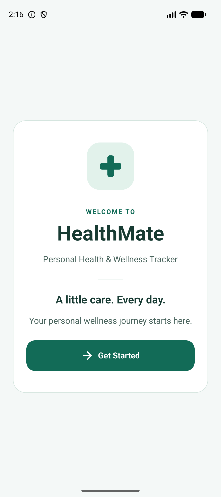
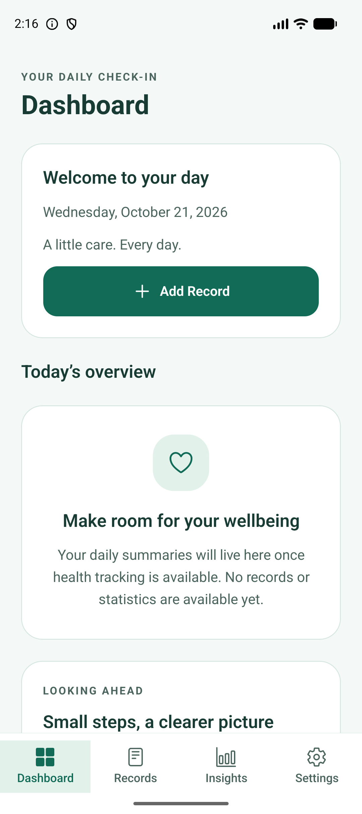
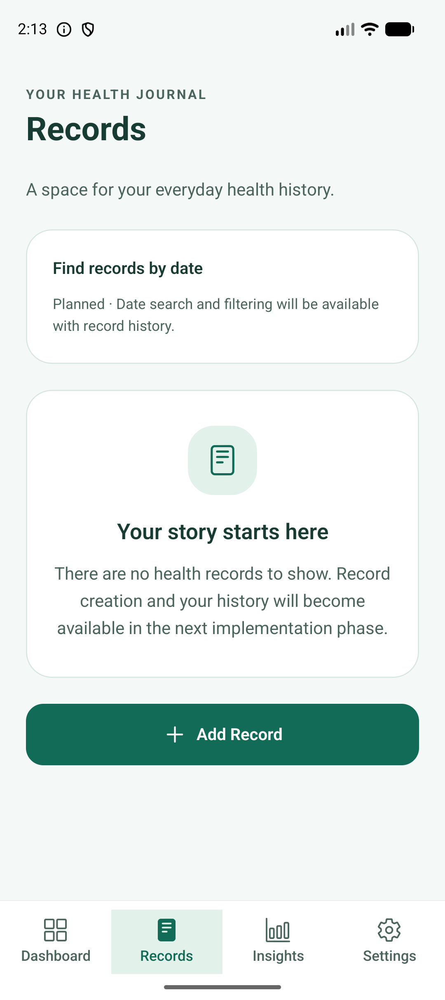
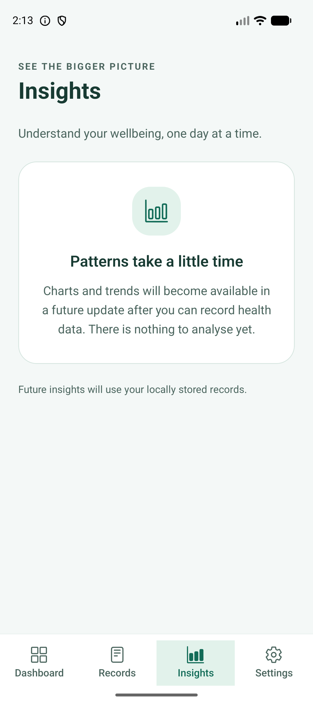
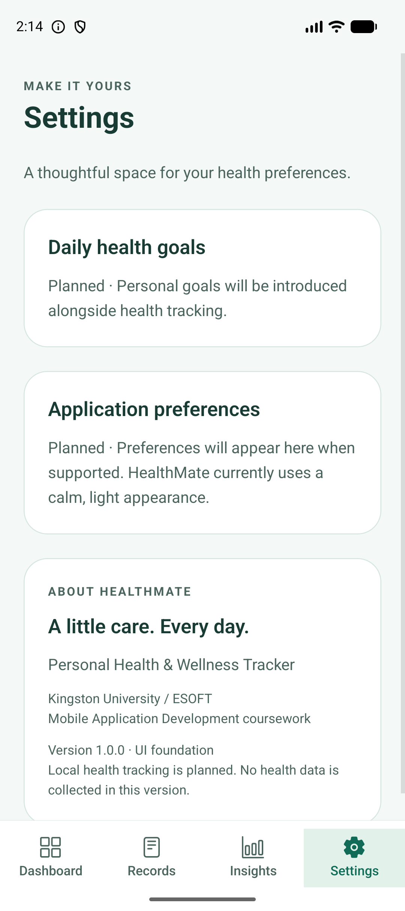
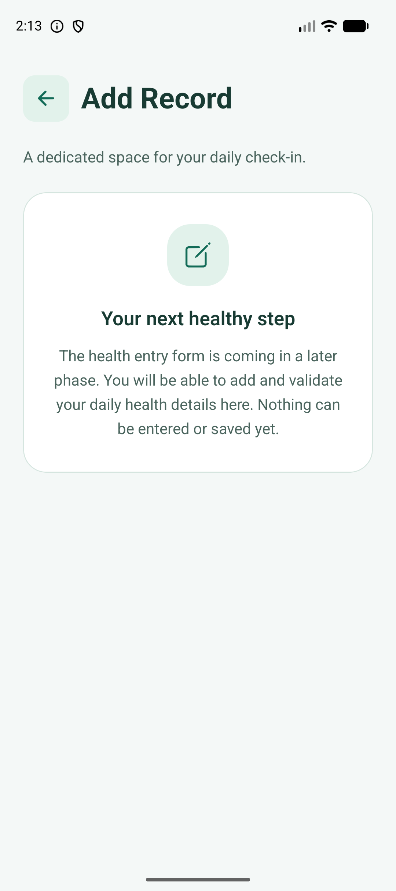

# HealthMate UI foundation

## Design intent

A calm green identity keeps the original welcome screen recognizable. White cards on a pale green background group related information without decorative charts or fake health statistics. Native system typography avoids a network/font dependency for text. Ionicons from the Expo-compatible vector-icons package provides consistent outline/filled destination symbols. Icons accompany text labels.

| Token | Value / purpose |
| --- | --- |
| Background | #F4F8F7, low-distraction screen canvas |
| Surface | #FFFFFF, content cards |
| Primary | #126B57, actions and selected destinations |
| Primary pressed | #0C5142, tactile action feedback |
| Primary soft | #E2F2EB, selected-tab and icon backgrounds |
| Text | #183B33, main reading color |
| Muted | #4B655E, supporting copy (not low-contrast gray) |
| Border | #D5E5DF, decorative grouping only |
| Typography | 12–38 pt roles, explicit line heights, native font scaling |
| Spacing | 4, 8, 12, 16, 24, 32, 40 pt |
| Radius | 12 pt small; 16 pt buttons; 24 pt cards/icons |
| Elevation | 0; subtle border provides separation |
| Icons | 20, 24, 32, 44 pt roles |
| Sizing | 48 pt touch minimum, 52 pt button minimum, 640 pt content maximum |

Text colors are used on light backgrounds; the primary button uses white text. Selected tabs use both filled icons and a pale background, alongside their labels. Color alone does not communicate navigation state.

## Used reusable components

- AppScreen: safe-area-aware scrolling container with constrained content width. Tabs own the bottom inset; standalone screens protect all four edges.
- AppHeader: single title, optional eyebrow and a labeled 48 pt Back control.
- AppText: semantic typography variants, native text props, and muted color.
- AppCard: consistent border, radius, padding, and internal spacing.
- AppButton: primary/secondary styles, pressed and disabled presentation, button role, disabled state, optional decorative icon. Only primary actions are currently used.
- AppIcon: typed Ionicons names; decorative icons hidden from accessibility.
- EmptyState: icon, title and honest explanation.
- HealthIcon: preserved local welcome cross.

## Coursework UX decisions

Four named destinations keep the information architecture predictable. Add Record is a separate stack screen so Android Back restores context. Welcome has no persistence or authentication. Date filtering and preferences are static planned sections, not misleading controls. No zero-value statistics, fake records, charts, functional forms, save buttons or toggles are presented.

Scrollable containers, wrapping copy, flexible buttons and capped content width support smaller screens and larger text. System bars remain outside content via safe-area insets. Screen headings have header roles; buttons and tabs have accessible labels. TalkBack and extreme font-scale validation remain separate manual checks.

## Maintainable initial wireframes

These are structural wireframes, not screenshots. All sections flow vertically and scroll when needed.

~~~text
WELCOME                  DASHBOARD
[Health cross]           [Eyebrow / Dashboard]
HealthMate               [Welcome / local current date]
Subtitle / brand copy    [Add Record button]
[Get Started]            Today's overview
                         [Honest summary empty state]
                         [Planned summary areas]
                         [Dashboard Records Insights Settings]

RECORDS                  INSIGHTS
[Eyebrow / Records]      [Eyebrow / Insights]
Intro                    Intro
[Date filtering planned] [Chart/trend empty state]
[Record-history empty]   Local-data explanation
[Add Record]             [Four tabs]
[Four tabs]

SETTINGS                 ADD RECORD
[Eyebrow / Settings]     [Back] Add Record
[Goals planned]          Intro
[Preferences planned]    [Upcoming form explanation]
[About / version]        No fields or save action
[Four tabs]              Android Back returns to invoking tab
~~~

## Genuine Android evidence

Captured from the Pixel 10 emulator, not generated mockups:

